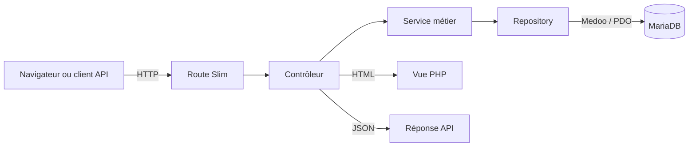
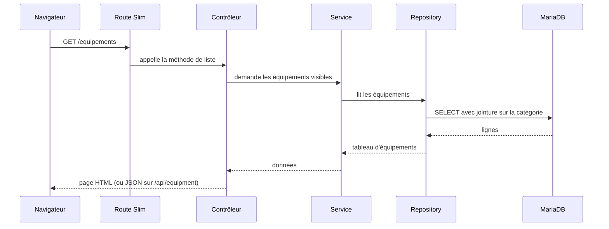

# Architecture MVC et Slim — RepairLab

## Le trajet d'une requête

## Rôle de chaque couche

| Couche | Rôle | Ce qu'elle ne fait pas |
|---|---|---|
| Route | Associe une méthode et une URL à un contrôleur | Aucune logique |
| Contrôleur | Lit la requête, appelle le service, choisit HTML ou JSON, renvoie le bon code HTTP | Ne contient aucune règle métier ni SQL |
| Service | Applique les règles métier (R1, R3, R6, R8, R9, R10) et les droits | Ne connaît ni HTML ni SQL |
| Repository | Lit et écrit en base avec Medoo ; appelle la procédure stockée | Ne prend aucune décision métier |
| Vue | Affiche du HTML échappé | Ne fait ni SQL ni décision de droit |
| Base de données | Contraintes, vues, trigger, procédure stockée | |

Les noms de fichiers sont à adapter à ceux de ton starter.

## Où vit chaque règle

| Règle | Service concerné | Aide de la base |
|---|---|---|
| R1 Réservation prioritaire | Service de réservation | `CRENEAU_PRIORITAIRE` |
| R3 Panne bloquante | Service de réservation | Vue des incidents ouverts |
| R6 Procédure d'un incident | Service d'incident | Trigger d'historique |
| R8 Trois pannes en trente jours | Service d'équipement | Vue des incidents ouverts |
| R9 Disponibilité expliquée | Service de disponibilité | Vue de disponibilité |
| R10 Validation qualité | Service d'intervention | Contrainte sur le dossier |

## Premier parcours à expliquer : la liste des équipements

## Principes

- Les règles s'appliquent de la même façon via un formulaire HTML et via l'API : le contrôleur appelle le même service.
- Le front React ne décide jamais d'une règle : il affiche ce que renvoie le serveur, y compris les refus.
- Aucune requête SQL concaténée avec des données utilisateur : requêtes paramétrées uniquement.
